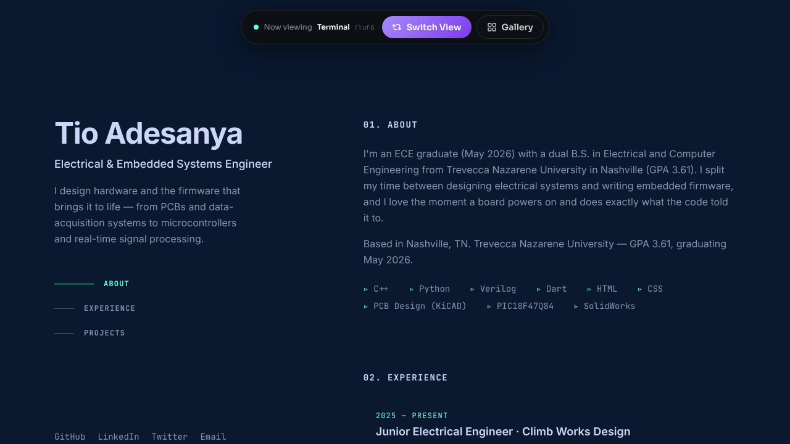

# Tio Adesanya — Portfolio (six views)

<!-- Live site: add the Netlify URL here once it's deployed -->



A single-page portfolio for **Tio Adesanya**, Electrical & Embedded Systems Engineer, that can be shown in six different designs. A "Switch View" control flips between them, and a gallery lets visitors pick one (or a random one).

## The six views

| View | Style |
| --- | --- |
| **Terminal** | Minimalist dark, sticky sidebar, neon-teal accents |
| **Circuit** | A PCB-themed board with copper traces, built for an EE |
| **Quilt** | A bold, colorful asymmetric grid of everything at once |
| **Lamp** | Cozy editorial serif with a pull-cord light/dark switch |
| **Playground** | Playful color blocks and floating shapes that follow the cursor |
| **Showcase** | Live previews of the real sites Tio has designed and deployed |

## What's on the site

- **About**: dual B.S. in Electrical and Computer Engineering, Trevecca Nazarene University (May 2026), plus a toolkit of C++, Python, Verilog, Dart, KiCAD, PIC18F47Q84 and SolidWorks.
- **Experience**: Climb Works Design (Junior Electrical Engineer) and Hayward Pool Products (Embedded Systems Engineer, part-time).
- **Projects**: 32-bit CPU in Verilog, Set-Gi-Box, Shaker Table, Embedded Voice Recorder, Arduino Robot, Microcontrollers Final, NeoceRA junior design, Virtual Assistant Bot.
- **Live sites**: [tiosanya.netlify.app](https://tiosanya.netlify.app/) and [tio-ai-port.netlify.app](https://tio-ai-port.netlify.app/).
- **Contact**: [GitHub](https://github.com/tioluwanimofe), [LinkedIn](https://linkedin.com/in/tioluwanimofe-adesanya), [Twitter](https://twitter.com/Mofe_Sanya), email.

## About this repo

This is the **compiled production build** (React + Vite, with Framer Motion), not the source code. It runs as-is on any static host.

```
index.html        entry page
assets/           bundled JS and CSS
images/           avatar and live-site preview screenshots
_redirects        Netlify rule so every path serves index.html
favicon.ico
```

## Run locally

```bash
python3 -m http.server 8000
# then open http://localhost:8000
```

## Deploy to Netlify

Connect this repo in Netlify with **no build command** and **publish directory `.`** (the repo root), or drag the folder onto Netlify Drop. The `_redirects` file is already set up.

> Note: the asset filenames were restored to the exact case `index.html` expects (`index-_MDSei62.js`, `index-DaHQUvPQ.css`). The uploaded zip had them lower-cased, which breaks the page on case-sensitive hosts like Netlify.
